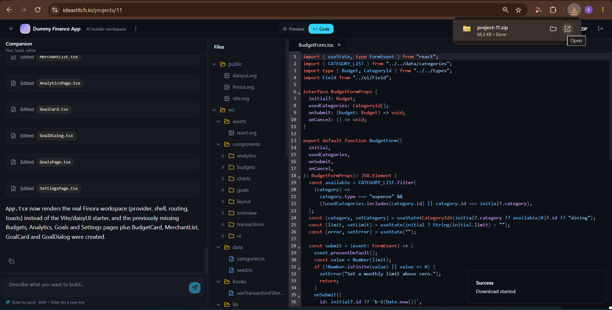
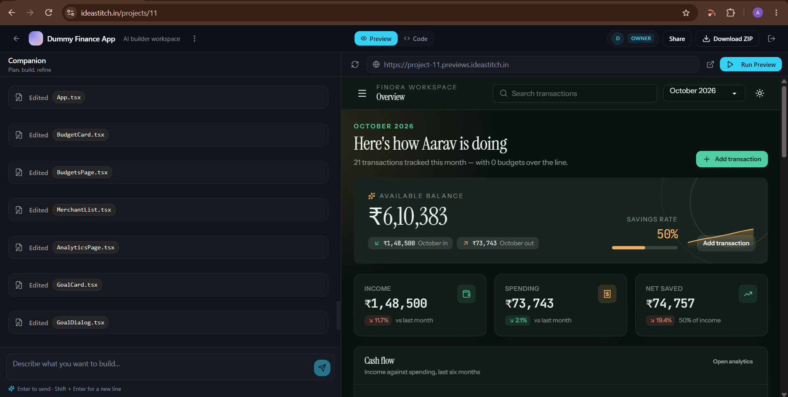
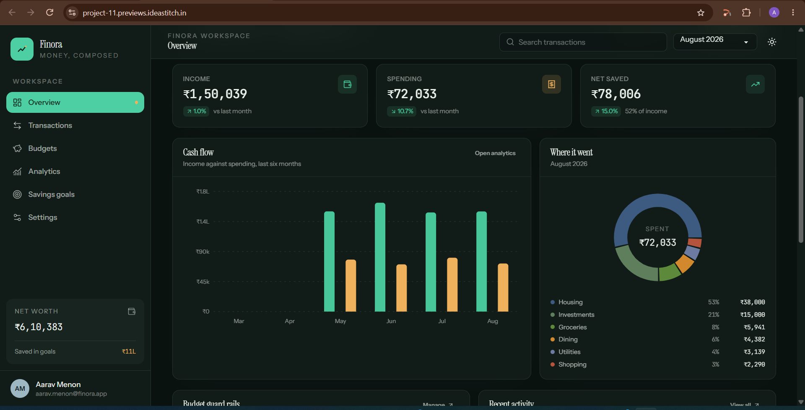
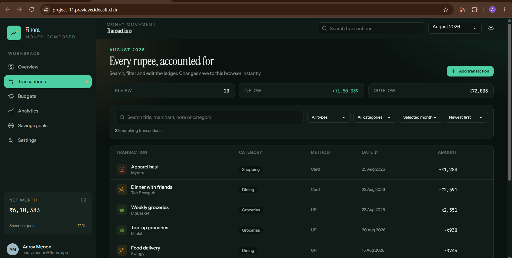
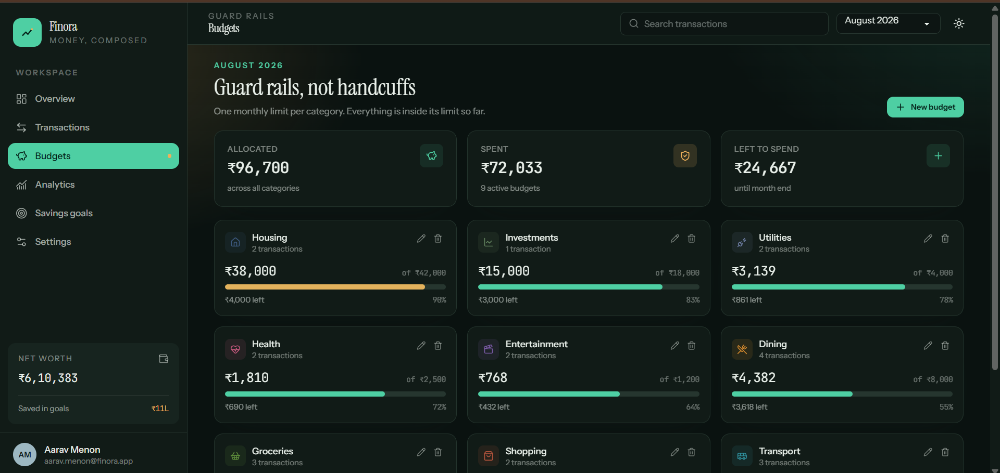
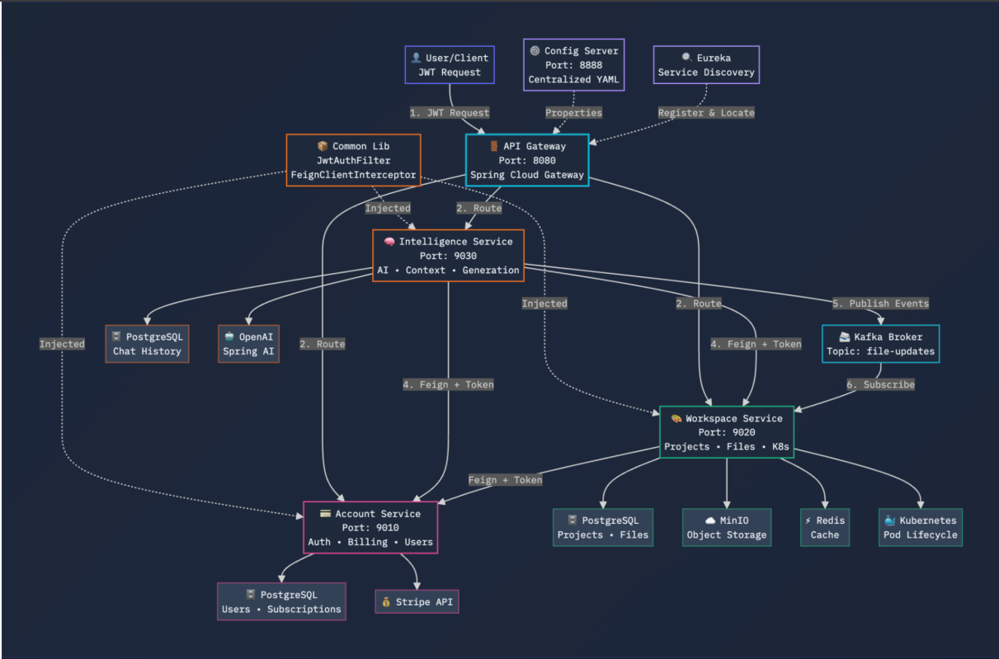
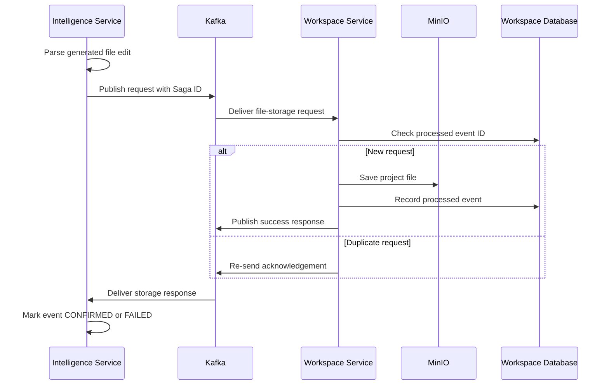
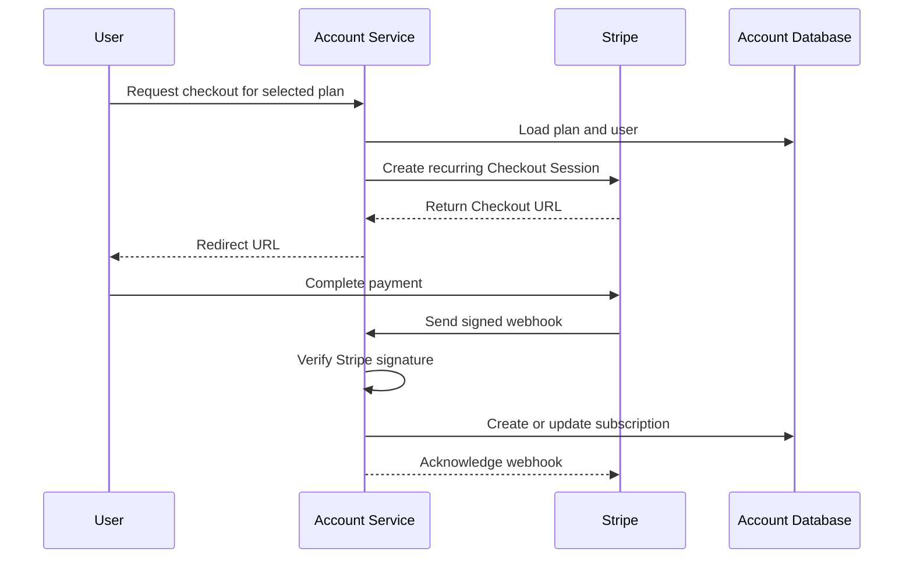
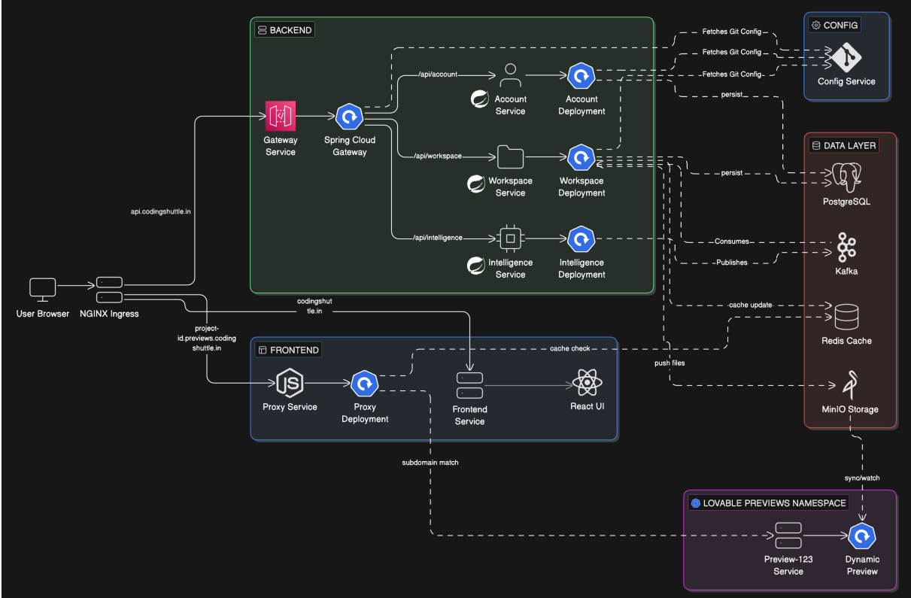
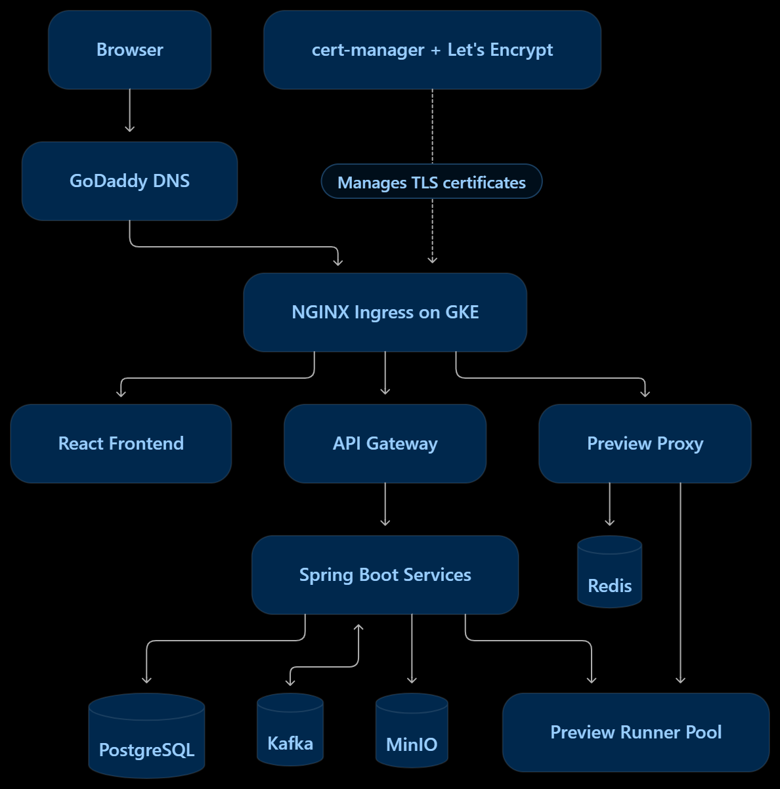

# ✨ IdeaStitch — AI-Powered Application Builder

> **From natural-language prompts to editable code and live applications.**

IdeaStitch is an AI-powered application builder that generates React applications from natural-language prompts. It
combines independently deployable Spring Boot services, Kafka-based file-storage coordination, persistent project files,
and Kubernetes-based preview environments.

🔗 **[Live Demo](https://ideastitch.in)** · **[Source Code](https://github.com/naidu-3009/lovable-microservices-clone)**


---

## 🎯 What can you do with IdeaStitch?

A user can sign up, create a project, describe an application, generate and edit code, launch an HTTPS preview, and
download the project source as a ZIP archive.

Behind that workflow, the platform coordinates AI generation, service-to-service communication, persistent file storage,
subscription-aware usage, and Kubernetes runner environments.

### Highlights

- 🤖 **AI code generation:** Spring AI integration, project-aware context, structured code edits, and streamed responses.
- 🧩 **Distributed backend:** Account, Workspace, and Intelligence services behind a Spring Cloud API Gateway.
- 🔄 **Event-driven persistence:** Kafka request/response events, Saga ID correlation, duplicate-event handling, and
  storage acknowledgements.
- ⚙️ **On-demand previews:** Kubernetes runner pool, Node.js/Vite execution, MinIO file synchronization, and Redis-based
  routing.
- 💳 **Subscriptions and billing:** Plan and subscription models, Stripe Checkout, customer portal, and webhook-driven
  status updates.
- ☁️ **Cloud deployment:** GKE, Docker Hub, GitHub Actions, DNS configuration, ingress routing, and automated TLS
  certificates.

## 📸 Screenshots

### AI Code Generation and ZIP Download



### Live HTTPS Preview



### Generated Application — Finora







## 🏗️ Architecture

IdeaStitch uses independently deployable Spring Boot services. External API calls pass through the API Gateway, while
the Workspace and Intelligence services coordinate code generation and file persistence through Kafka.

### Service-Level Architecture

This diagram shows the main services, their dependencies, and the
communication paths between the backend components.



### Service responsibilities

| Component                   | Responsibility                                                                                       |
|-----------------------------|------------------------------------------------------------------------------------------------------|
| **API Gateway (`api-gtw`)** | Routes requests to backend services and applies gateway-level authentication and CORS configuration. |
| **Account Service**         | Signup, login, account records, plans, subscription status, and Stripe integration.                  |
| **Workspace Service**       | Project CRUD, membership management, file operations, ZIP export, and preview provisioning.          |
| **Intelligence Service**    | AI prompts, project-file context, code generation, chat history, and usage tracking.                 |
| **Config Service**          | Centralized configuration loaded from a Git-backed repository.                                       |
| **Discovery Service**       | Service discovery for local development; disabled in the supplied Kubernetes profile.                |
| **Common Library**          | Shared DTOs, event contracts, authentication utilities, enums, and exception handling.               |
| **Preview Proxy**           | Resolves preview routes from Redis and forwards requests to the relevant runner.                     |

The platform uses PostgreSQL for relational data, MinIO for project files, Redis for preview routing, and Kafka for
asynchronous event coordination.

## 🤖 AI Generation and File Management

The Intelligence service integrates with an external LLM through Spring AI. It includes components for prompt
construction, project-file context, structured response parsing, and streaming chat events.

A typical generation workflow is:

1. The frontend sends a prompt to the Intelligence service.
2. The service constructs the request with the available project context and calls the configured LLM.
3. Generated output is parsed into messages, tool calls, and file edits.
4. File-storage requests are published to Kafka.
5. The Workspace service writes the generated files to MinIO.
6. Acknowledgements return through Kafka, allowing the Intelligence service to update event status.

### 🔄 Saga-correlated file-storage workflow

The file-storage workflow uses a Saga ID to correlate each request with its acknowledgement. The Workspace service also
stores processed event IDs so duplicate deliveries can be recognized.



A representative excerpt from `FileStorageConsumer`:

```java

@KafkaListener(
        topics = "file-storage-request-event",
        groupId = "workspace-group"
)
@Transactional
public void consumeFileEvent(FileStoreRequestEvent event) {
    if (processedEventRepository.existsById(event.sagaId())) {
        sendResponse(event, true, null);
        return;
    }

    try {
        projectFileService.saveFile(
                event.projectId(),
                event.filePath(),
                event.content()
        );

        processedEventRepository.save(
                new ProcessedEvent(event.sagaId(), LocalDateTime.now())
        );

        sendResponse(event, true, null);
    } catch (Exception e) {
        sendResponse(event, false, e.getMessage());
    }
}
```

This pattern makes the file-storage workflow observable and duplicate-aware at the application level. It does not claim
exactly-once processing across the entire distributed system.

The event topics used by the implementation are `file-storage-request-event` and `file-store-responses`.

## ⚙️ Kubernetes-Based Preview Environments

IdeaStitch executes generated applications in a runner pool rather than inside the Spring Boot processes.

The Workspace service uses the Fabric8 Kubernetes Client to manage runner pods in the `lovable-previews` namespace. Each
runner pod contains two containers:

- **Runner:** Node.js environment that installs dependencies and starts the Vite development server.
- **Syncer:** Uses the MinIO client to copy and synchronize project files into a shared workspace.

### Preview lifecycle

1. The Workspace service finds an existing runner for the project or claims an idle runner.
2. The syncer copies the project files from MinIO into the runner workspace.
3. The runner installs dependencies and starts the Vite server on port `5173`.
4. A project-specific route is registered in Redis.
5. The service returns an HTTPS preview URL.
6. The Node.js reverse proxy resolves the hostname from Redis and forwards the request to the runner.

The current implementation assigns a six-hour TTL to preview-route entries in Redis.

The runner pool is defined in `k8s/infra/runner-pool.yaml`. The `lovable-core` and `lovable-previews` namespaces are
configured separately, with distinct network-policy manifests.

## 💳 Plans, Pricing, Subscriptions, and Stripe

The Account service contains database-backed `Plan` and `Subscription` models. A plan stores the associated Stripe Price
ID, allowing the backend to create subscription checkout sessions based on the selected plan.

The billing integration includes:

- Subscription retrieval and plan-related limits.
- Stripe Checkout sessions for recurring subscriptions.
- Stripe Customer Portal sessions.
- Webhook handling to synchronize local subscription state.
- Handling for `checkout.session.completed`, `customer.subscription.updated`, `customer.subscription.deleted`,
  `invoice.paid`, and `invoice.payment_failed`.

### Payment lifecycle



The webhook controller verifies the Stripe signature before handing the event to the payment processor. The core
verification call is:

```java
Event event = Webhook.constructEvent(
        payload,
        signatureHeader,
        webhookSecret
);

paymentProcessor.

handleWebhookEvent(
        event.getType(),

stripeObject,
metadata
);
```

The processor handles the event types listed above and delegates subscription updates to the subscription service. Keep
Stripe API keys and webhook signing secrets in environment configuration or Kubernetes Secrets.

## ☁️ Cloud Deployment on Google Kubernetes Engine

The live application is deployed to Google Kubernetes Engine.

| Setting           | Value                           |
|-------------------|---------------------------------|
| GCP project       | `lovable-microservices-clone`   |
| GKE cluster       | `lovable-microservices-cluster` |
| Region            | `asia-south2`                   |
| Core namespace    | `lovable-core`                  |
| Preview namespace | `lovable-previews`              |

The deployment uses Kubernetes Deployments and Services for application workloads, StatefulSets and persistent volumes
for stateful dependencies, ConfigMaps for non-sensitive configuration, and Secrets for runtime credentials.

The supporting infrastructure includes PostgreSQL/pgvector, Kafka, Redis, and MinIO. The frontend, backend services, and
preview proxy are deployed separately.

### GKE Deployment Architecture

The following diagram illustrates how the application services, ingress,
stateful infrastructure, and preview runner pool are deployed and connected.



## 🌐 Custom Domain and HTTPS

The public application uses a custom domain registered with GoDaddy:

**[https://ideastitch.in](https://ideastitch.in)**

GoDaddy manages DNS. A records route the root domain, API hostname, and wildcard preview hostname to the GKE ingress
endpoint; `www` uses a CNAME to the root domain.

### Domain, DNS, and TLS Flow

GoDaddy manages the domain's DNS records, while cert-manager and Let's
Encrypt manage certificate issuance and renewal for the GKE ingress.



| Hostname                   | Ingress destination      |
|----------------------------|--------------------------|
| `ideastitch.in`            | `lovable-frontend:80`    |
| `www.ideastitch.in`        | `lovable-frontend:80`    |
| `api.ideastitch.in`        | `api-gtw:80`             |
| `*.previews.ideastitch.in` | `lovable-micro-proxy:80` |

### 🔐 TLS certificate management

The live deployment uses:

- NGINX Ingress Controller for hostname-based routing and TLS termination.
- cert-manager to manage Kubernetes certificate resources.
- Let's Encrypt to issue certificates.
- A GoDaddy DNS webhook for DNS-01 validation of the wildcard preview certificate.

| Kubernetes TLS Secret   | Covered hostnames                                         |
|-------------------------|-----------------------------------------------------------|
| `ideastitch-tls`        | `ideastitch.in`, `www.ideastitch.in`, `api.ideastitch.in` |
| `wildcard-previews-tls` | `*.previews.ideastitch.in`                                |

The main-domain certificate uses the `letsencrypt-prod` issuer in the supplied configuration. The wildcard preview
certificate is managed using the `letsencrypt-godaddy-prod` ClusterIssuer and the GoDaddy webhook.

The wildcard DNS record allows project-specific subdomains to work without creating a separate DNS record for every
generated application. cert-manager manages the certificate lifecycle and renewal.

**A separate commercial SSL certificate is not required:** Let's Encrypt issues the certificates, while the domain
registration remains with GoDaddy.

### Effective wildcard TLS configuration

The live Ingress configuration references the wildcard TLS Secret separately from the main-domain certificate:

```yaml
tls:
  - hosts:
      - ideastitch.in
      - www.ideastitch.in
      - api.ideastitch.in
    secretName: ideastitch-tls

  - hosts:
      - "*.previews.ideastitch.in"
    secretName: wildcard-previews-tls
```

The uploaded `k8s/infra/ingress.yaml` is an older snapshot and does not yet contain the wildcard TLS entry. The live
wildcard setup also requires the GoDaddy webhook and `letsencrypt-godaddy-prod` ClusterIssuer. Update the committed
manifests to match the working cluster before attempting a clean-cluster recreation.

## 🚀 CI/CD with GitHub Actions

GitHub Actions automates backend image builds and deployments to GKE.

The service workflows follow this pattern:

1. Trigger on relevant changes to the configured branch and paths.
2. Set up JDK 21 and build the required Maven modules.
3. Build and publish container images to Docker Hub using Jib.
4. Authenticate to Google Cloud using Workload Identity Federation.
5. Obtain credentials for the target GKE cluster.
6. Update the relevant Kubernetes Deployment.
7. Wait for the rollout to complete.

A representative deployment step from a backend workflow:

```yaml
- name: Deploy to GKE
  run: |
    kubectl set image deployment/${{ env.SERVICE_NAME }} \
      ${{ env.SERVICE_NAME }}=${{ env.IMAGE_NAME }}:${{ github.sha }} \
      -n lovable-core

    kubectl rollout status \
      deployment/${{ env.SERVICE_NAME }} \
      -n lovable-core
```

The frontend workflow goes further: it publishes an image, deploys the exact image digest, waits for rollout completion,
verifies the configured image reference, and performs smoke checks against the frontend container and public website.

The repository's workflows are under `.github/workflows/`. They require configured GitHub Actions secrets for Docker
Hub, Google Cloud Workload Identity Federation, the GKE cluster, and its region.

## 🗂️ Kubernetes Manifest Guide

| Path                                      | Purpose                                                       |
|-------------------------------------------|---------------------------------------------------------------|
| `k8s/infra/namespaces.yaml`               | Namespaces and shared non-sensitive configuration.            |
| `k8s/infra/ingress.yaml`                  | Public hostname routing for frontend, API, and preview proxy. |
| `k8s/infra/letsencrypt-prod.yaml`         | HTTP-01 Let's Encrypt ClusterIssuer configuration.            |
| `k8s/infra/runner-pool.yaml`              | Runner and syncer containers for generated applications.      |
| `k8s/infra/core-network-policies.yaml`    | Network policies for core workloads.                          |
| `k8s/infra/preview-network-policies.yaml` | Network policies for preview workloads.                       |
| `k8s/services/account-service.yaml`       | Account service deployment and service.                       |
| `k8s/services/api-gtw.yaml`               | API Gateway deployment and service.                           |
| `k8s/services/config-service.yaml`        | Config Server deployment and service.                         |
| `k8s/services/frontend.yaml`              | Frontend deployment and service.                              |
| `k8s/services/intelligence-service.yaml`  | Intelligence service deployment and service.                  |
| `k8s/services/workspace-service.yaml`     | Workspace service and preview-management permissions.         |
| `k8s/stateful/pgvector.yaml`              | PostgreSQL/pgvector and persistent storage.                   |
| `k8s/stateful/kafka.yaml`                 | Kafka StatefulSet and persistence.                            |
| `k8s/stateful/minio.yaml`                 | MinIO and persistent storage.                                 |
| `k8s/stateful/redis.yaml`                 | Redis StatefulSet and persistence.                            |
| `k8s/proxy/proxy-deployment.yaml`         | Node.js preview proxy deployment.                             |
| `k8s/computeclass-83gb.yaml`              | Optional GKE ComputeClass configuration.                      |

The ingress controller and GoDaddy cert-manager webhook are installed separately from the application manifests. Review
the cluster-specific settings, service accounts, Secrets, storage, and ingress configuration before applying these files
to another cluster.

## 🔌 API Overview

The API Gateway exposes three main service prefixes:

- `/api/v1/account/**`
- `/api/v1/workspace/**`
- `/api/v1/intelligence/**`

Representative routes include:

| Method   | Gateway route                                                   | Purpose                                       |
|----------|-----------------------------------------------------------------|-----------------------------------------------|
| `POST`   | `/api/v1/account/auth/signup`                                   | Register an account.                          |
| `POST`   | `/api/v1/account/auth/login`                                    | Authenticate and obtain a JWT.                |
| `GET`    | `/api/v1/workspace/projects`                                    | List accessible projects.                     |
| `POST`   | `/api/v1/workspace/projects`                                    | Create a project.                             |
| `PATCH`  | `/api/v1/workspace/projects/{projectId}`                        | Update a project.                             |
| `DELETE` | `/api/v1/workspace/projects/{projectId}`                        | Delete a project.                             |
| `GET`    | `/api/v1/workspace/projects/{projectId}/files`                  | Get a project's file tree.                    |
| `GET`    | `/api/v1/workspace/projects/{projectId}/files/content?path=...` | Get file contents.                            |
| `GET`    | `/api/v1/workspace/projects/{projectId}/files/download-zip`     | Download a project's source as a ZIP archive. |
| `POST`   | `/api/v1/workspace/projects/{projectId}/deploy`                 | Provision or refresh a preview.               |
| `POST`   | `/api/v1/intelligence/chat/stream`                              | Stream AI-generation events using SSE.        |
| `GET`    | `/api/v1/intelligence/chat/projects/{projectId}`                | Retrieve project chat history.                |
| `GET`    | `/api/v1/account/api/me/subscription`                           | Retrieve current subscription details.        |
| `POST`   | `/api/v1/account/api/payment/checkout`                          | Create a Stripe Checkout session.             |
| `POST`   | `/api/v1/account/api/payment/portal`                            | Create a Stripe Customer Portal session.      |
| `POST`   | `/api/v1/account/webhooks/payment`                              | Receive and verify Stripe webhook events.     |

Protected routes require the appropriate JWT. Internal account and workspace endpoints support service-to-service
communication and should not be treated as public APIs.

## 🧰 Local Development

### Prerequisites

- JDK 21
- Node.js and pnpm
- Docker
- `kubectl` and a Kubernetes environment for preview workflows
- Access to the configured LLM provider
- Access to the Git-backed configuration repository
- Stripe test credentials if testing subscription workflows

### Build the common library

Linux or macOS:

```bash
cd common-library
./mvnw clean install
```

Windows PowerShell:

```powershell
cd common-library
.\mvnw.cmd clean install
```

### Build or test a backend service

For example:

```bash
cd account-service
./mvnw test
```

Then use the appropriate service configuration and infrastructure to run it. Repeat for the required service modules.
Build the common library first for services that depend on it.

### Run the frontend

```bash
cd lovable-frontend
pnpm install
pnpm dev
```

A complete local environment must also provide PostgreSQL, Kafka, MinIO, Redis, the Config Server, and required
credentials. Preview functionality additionally depends on the Kubernetes runner and proxy setup.

The GKE manifests are environment-specific. Do not blindly apply them to a local or unrelated cluster without checking
namespaces, image references, Secrets, storage, TLS, and network policies.

## 🧪 Testing

The repository contains basic test scaffolding in the backend modules and a frontend test setup. These checks are a
starting point, not comprehensive business-logic or end-to-end coverage.

Backend modules:

```bash
./mvnw test
```

Frontend:

```bash
cd lovable-frontend
pnpm test
```

High-value tests to add include project-level authorization, Saga duplicate-event handling, failed storage
acknowledgements, subscription webhook processing, preview lifecycle failures, and the complete signup-to-ZIP-download
journey.

## 🔒 Security and Reliability

- Never commit populated environment files, API keys, database passwords, JWT signing secrets, Stripe secrets, or DNS
  API credentials.
- Enforce project ownership and membership checks for project files, generated code, and ZIP exports.
- Treat generated code and dependency installation as untrusted operations.
- Restrict Workspace service permissions to the Kubernetes resources it needs to manage.
- Monitor Kafka consumer failures, pending file-storage events, and preview provisioning errors.
- Keep the tracked Kubernetes manifests synchronized with the live TLS and ingress configuration.
- Validate recovery behavior for external API failures, runner startup failures, and interrupted storage workflows.

## 🛣️ Future Improvements

- Expand unit and integration test coverage across service boundaries.
- Add end-to-end tests for the full application-building workflow.
- Improve recovery and observability for incomplete file-storage operations.
- Add cleanup for expired preview routes and abandoned runner environments.
- Make TLS, ingress, and GKE setup reproducible from a clean cluster.
- Add architecture decision records for important trade-offs and failure-handling behavior.

---

IdeaStitch is an independent engineering project inspired by AI-assisted application builders. It is not affiliated with
or endorsed by Lovable.dev.